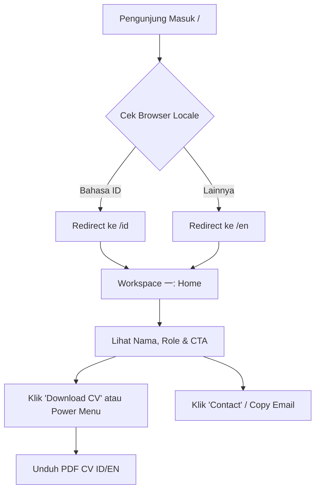
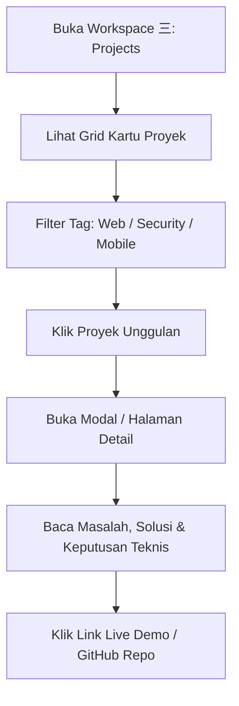

# User Flows

Dokumen ini memetakan alur interaksi utama pengunjung portofolio.

## Flow 1: Kunjungan Recruiter (Cepat ≤ 30 Detik)

## Flow 2: Reviewer Proyek & Tech Lead

## Flow 3: Navigasi Keyboard & Power User

1. Pengunjung menekan `1` s.d. `7` atau `Alt + 1` s.d. `Alt + 7` untuk berpindah workspace seketika tanpa reload.
2. Pengunjung menekan `?` untuk menampilkan popover daftar shortcut.
3. Pengunjung menekan `Cmd+K` atau `Ctrl+K` untuk membuka Command Palette (pencarian cepat proyek, artikel, aksi copy email).
4. Pengunjung menekan workspace `八〜十`: muncul popover ramah *"Workspace ini kosong, balik ke 一"* dengan tombol pengarah kembali.

## Flow 4: Pemilihan Bahasa & Tema

- **Bahasa**: Pengunjung mengklik toggle `ID / EN` di top bar. URL otomatis berubah ke `/id/...` atau `/en/...` tanpa full-reload. Pilihan disimpan di `localStorage` dan cookie.
- **Tema**: Pengunjung mengklik ikon bulan/matahari di status bar kanan. Tema beralih antara dark dan light. Pilihan menimpa preferensi sistem `prefers-color-scheme`.
